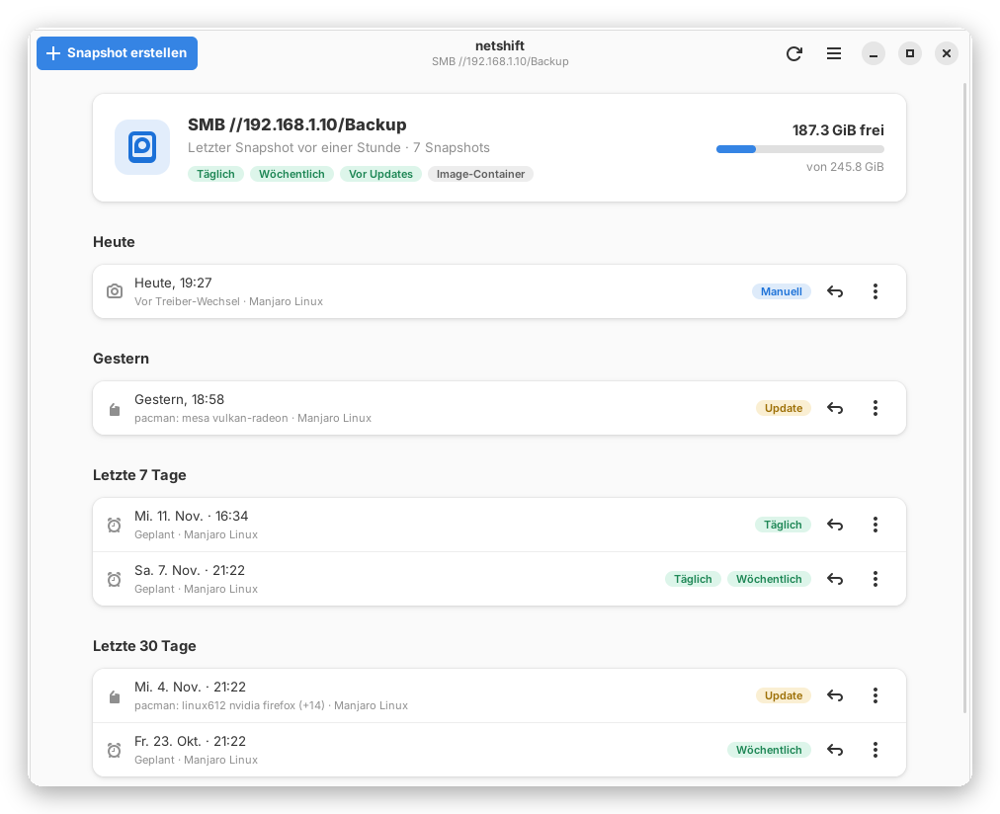
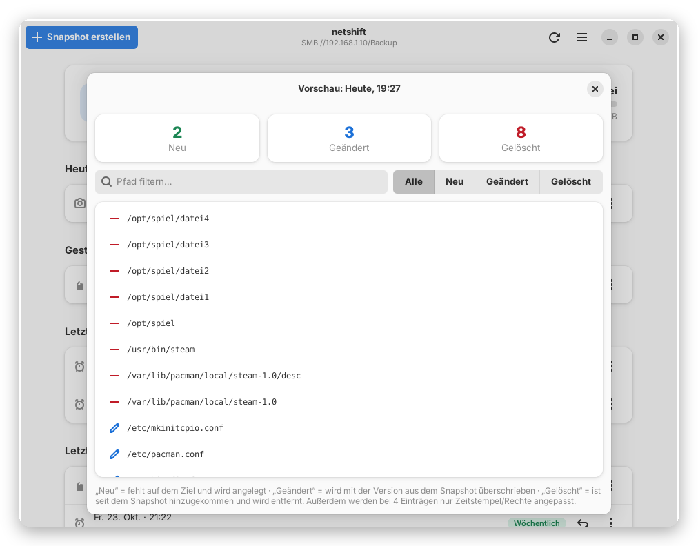
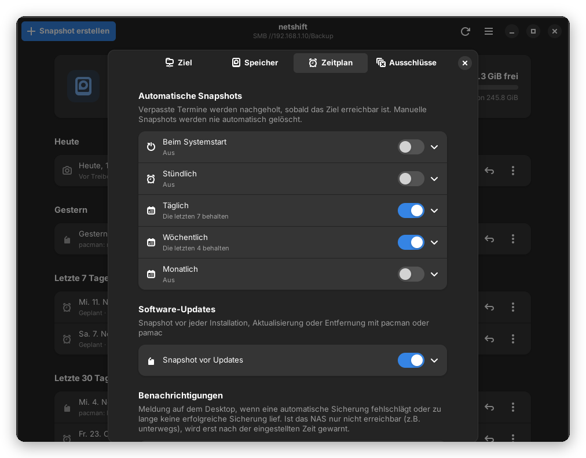

# netshift

[🇬🇧 English](README.md) · 🇩🇪 Deutsch

System-Snapshots für Manjaro/Arch – wie Timeshift, aber auch auf **NAS (SMB), NFS und SSH**.

<p align="center">
  
</p>

<table>
  <tr>
    <td width="50%"></td>
    <td width="50%"></td>
  </tr>
</table>

## Funktionen

- **Sicherungsziele:** NAS/Windows-Freigabe (SMB), NFS, SSH-Server, USB-Laufwerk oder lokaler Ordner
- **Inkrementell:** Der erste Snapshot kopiert das System, danach nur Änderungen – unveränderte Dateien werden per Hardlink geteilt
- **Alle Linux-Rechte bleiben erhalten**, auch auf dem NAS (ext4-Image-Container, optional mit LUKS2 verschlüsselt)
- **Automatisch:** beim Start, stündlich, täglich, wöchentlich, monatlich und vor jedem pacman-/pamac-Update – verpasste Termine werden nachgeholt
- **Wiederherstellen mit Vorschau:** erst sehen, was sich ändern würde; auch einzelne Dateien zurückholen
- **Rettungs-Stick:** ein System, das nicht mehr startet, von einem Linux-USB-Boot-Stick zurückspielen – auch auf verschlüsselte Platten
- **Sicher:** Sicherheits-Snapshot vor jeder Wiederherstellung, abgebrochene Sicherungen werden fortgesetzt, kein Hängen bei WLAN-Abbruch oder beim Herunterfahren
- **Benachrichtigung**, wenn eine Sicherung fehlschlägt oder die letzte zu alt ist
- Moderne GTK4-Oberfläche mit Dunkelmodus, klassische Oberfläche und Terminal als Rückfall
- Deutsch und Englisch – die Sprache wird automatisch erkannt

## Installation

```bash
git clone https://github.com/riccen-arch/netshift.git && cd netshift && sudo sh install.sh
```

Der Installer ergänzt nur fehlende Pakete und funktioniert auch auf einem veralteten Live-USB-Stick.
Aktualisieren: `cd netshift && git pull && sudo sh install.sh`

## Erste Schritte

1. **netshift** im Startmenü öffnen
2. **Einstellungen → Sicherungsziel:** z.B. SMB, Server `192.168.1.10`, Freigabe `backup`, Benutzer und Passwort → *Testen*
3. **Snapshot erstellen** – fertig. Den Zeitplan unter *Einstellungen → Zeitplan* festlegen.

**Tipp:** netshift auch auf einem Linux-USB-Boot-Stick installieren (Arch-basiert, z.B. Manjaro, EndeavourOS oder Arch)
und *Rettungssystem – nur wiederherstellen* einschalten. Startet der Rechner nicht mehr, lässt sich das System vom Stick aus zurückspielen.

## Voraussetzungen

Manjaro oder Arch Linux · Python 3 · rsync – alles Weitere installiert der Installer.

📖 **[Ausführliche Anleitung](docs/ANLEITUNG.md)** (Einrichtung, Wiederherstellen, Rettungs-Stick, Befehle) · Lizenz: GPL-3.0
