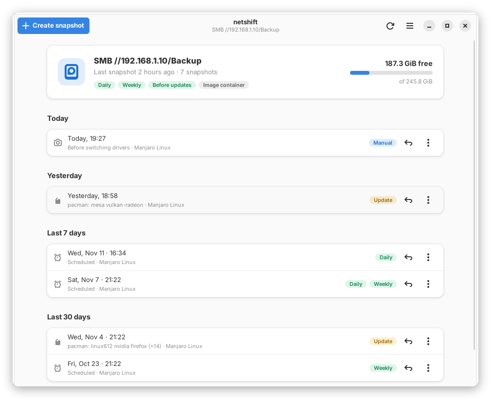
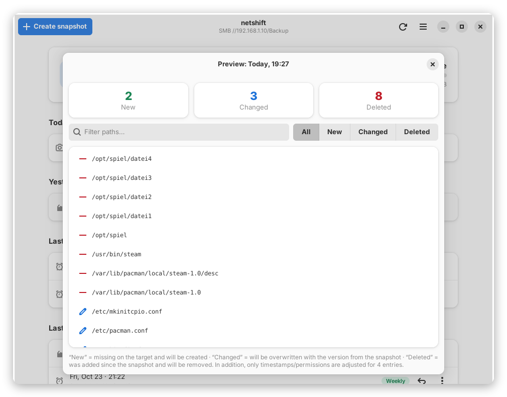
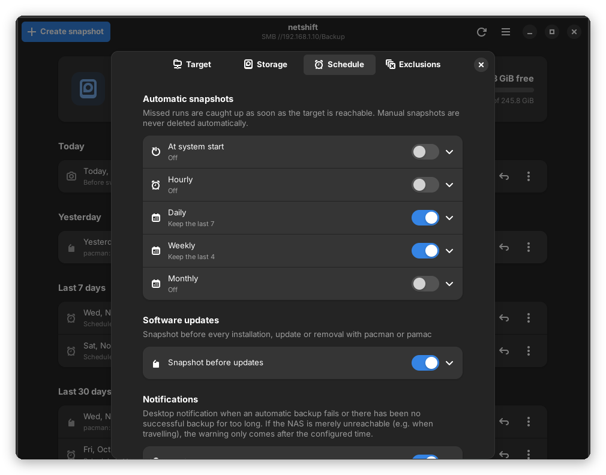

# netshift

🇬🇧 English · [🇩🇪 Deutsch](README.de.md)

System snapshots for Manjaro/Arch – like Timeshift, but also to a **NAS (SMB), NFS and SSH**.

<p align="center">
  
</p>

<table>
  <tr>
    <td width="50%"></td>
    <td width="50%"></td>
  </tr>
</table>

## Features

- **Backup targets:** NAS/Windows share (SMB), NFS, SSH server, USB drive or local folder
- **Incremental:** the first snapshot copies the system, after that only changes – unchanged files are shared via hard links
- **All Linux permissions preserved**, even on a NAS (ext4 image container, optionally encrypted with LUKS2)
- **Automatic:** at boot, hourly, daily, weekly, monthly and before every pacman/pamac update – missed runs are caught up
- **Restore with preview:** see what would change before anything is touched; single files can be restored too
- **Rescue stick:** restore a system that no longer boots from a Manjaro USB stick – also onto encrypted disks
- **Safe:** safety snapshot before every restore, interrupted backups are resumed, no hang on Wi-Fi loss or at shutdown
- **Notifications** when a backup fails or the last one is too old
- Modern GTK4 interface with dark mode, classic interface and command line as fallback
- English and German – the language is detected automatically

## Installation

```bash
git clone https://github.com/riccen-arch/netshift.git && cd netshift && sudo sh install.sh
```

The installer only adds missing packages and also works on an outdated live USB stick.
Update: `cd netshift && git pull && sudo sh install.sh`

## Getting started

1. Open **netshift** from the application menu
2. **Settings → Backup target:** e.g. SMB, server `192.168.1.10`, share `backup`, user and password → *Test*
3. **Create snapshot** – done. Set up the schedule under *Settings → Schedule*.

**Tip:** install netshift on a Manjaro USB stick as well and enable *Rescue system – restore only*.
If the computer no longer boots, the system can be restored from the stick.

## Requirements

Manjaro or Arch Linux · Python 3 · rsync – everything else is installed by the installer.

📖 **[Full guide](docs/GUIDE.md)** (setup, restore, rescue stick, commands) · License: GPL-3.0
